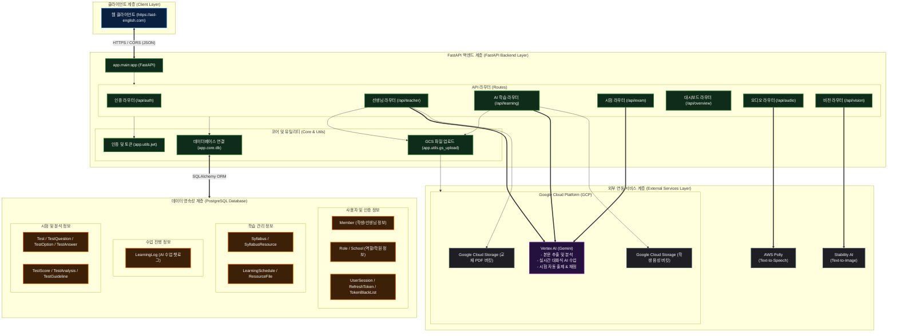

### 아키텍처 다이어그램

## 주요 구성 요소 설명

### 1. 클라이언트 계층
* `https://aid-english.com` 주소로 배포된 웹 프론트엔드 애플리케이션임 (현재는 폐쇄)
* 백엔드 API와는 CORS 정책(자격증명 포함) 하에 HTTPS를 통해 통신하며 JSON 포맷의 데이터를 교환함

### 2. FastAPI 백엔드 계층
* **API Routers**: 기능별 엔드포인트를 제공함
  * `auth`: 회원가입, 로그인, 토큰 갱신, 로그아웃 등 세션 관리
  * `teacher`: 선생님 대시보드 데이터 조회, 학생 및 학습 계획 관리, 학원 관리 등
  * `learning`: AI와 함께하는 실시간 영어 수업(문법, 작문, 리딩, 스피킹) 진행 및 학습 로그 기록
  * `exam`: 학습 내용 기반 단어/리딩/작문 시험 생성 및 학생 답안 자동 채점 & 평가
  * `audio`: 텍스트 기반 TTS 음성 합성 및 오디오 스트림 반환
  * `vision`: 단어 연상 그림 및 교재 리소스 일러스트 생성 지원
* **Core & Utils**: 데이터베이스 커넥션 풀(SQLAlchemy) 관리, JWT 토큰 인코딩/디코딩, Google Cloud Storage 파일 업로드 유틸리티 등을 수행함

### 3. 외부 연동 서비스 계층
* **Google Vertex AI (Gemini)**: 
  * 학습 일정에 필요한 PDF 교재 내용 추출
  * 문법, 쓰기, 말하기, 읽기 등 실시간 인터랙티브 수업 생성 및 스트리밍 지원
  * AI 기반 단어/읽기/쓰기 시험 생성 및 자동 채점
  * 시험 결과 요약 및 학습 추천 가이드라인 생성
* **Google Cloud Storage (GCS)**:
  * 교재 PDF 및 수업 첨부파일 저장용 버킷
  * 학생이 제출한 음성 녹음 파일 저장용 버킷
* **AWS Polly**: TTS(Text-to-Speech)를 활용하여 자연스러운 원어민 음성을 실시간 오디오 스트림 파일로 생성 및 배포
* **Stability AI**: 텍스트 프롬프트를 바탕으로 고품질 교육용 이미지를 자동 생성하여 화면에 노출

### 4. 데이터 영속성 계층 (PostgreSQL Database)
* **SQLAlchemy ORM**을 통해 모든 데이터를 관계형으로 저장하고 쿼리함
* **회원 및 세션**: 학원 및 역할 정보, 로그인 상태 유지를 위한 사용자 세션 및 리프레시 토큰, 로그아웃된 토큰 블랙리스트를 관리함
* **학습 계획 및 일정**: 교재별 실습 코스가 정의된 Syllabus, 세부 학습 날짜와 본문이 포함된 LearningSchedule을 관리함
* **수업 진행 정보**: 실시간 AI 튜터와 주고받은 메시지 로그를 누적 기록하여 문법/쓰기/읽기/말하기별 흐름을 유지함
* **시험 및 평가**: 스케줄에 따른 시험 생성 정보(문제, 보기, 학생 제출 답안)와 점수, 분석 레포트, 맞춤 가이드라인을 저장함
