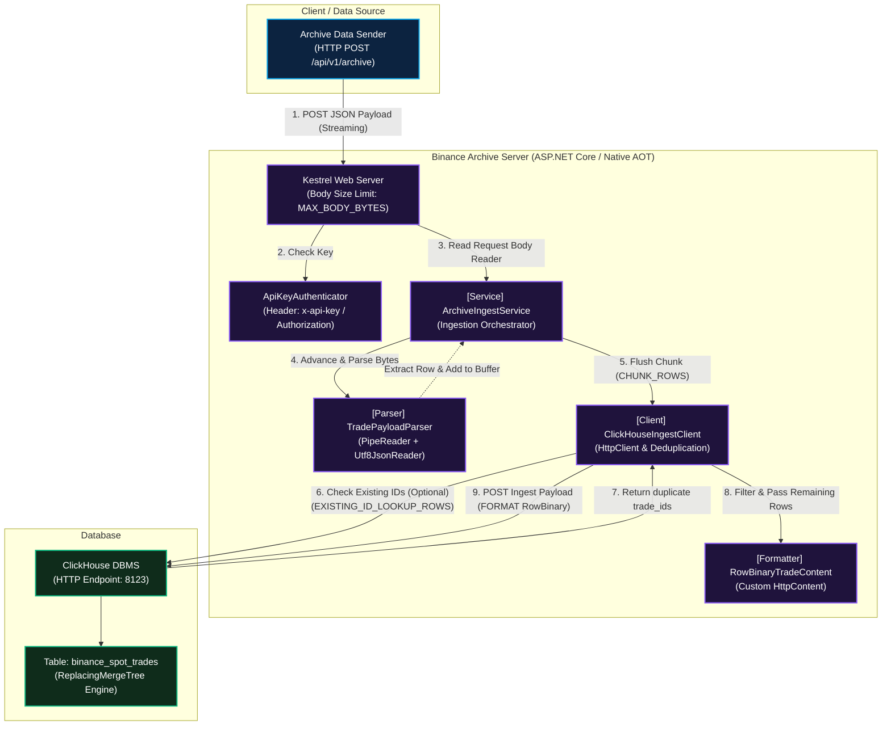
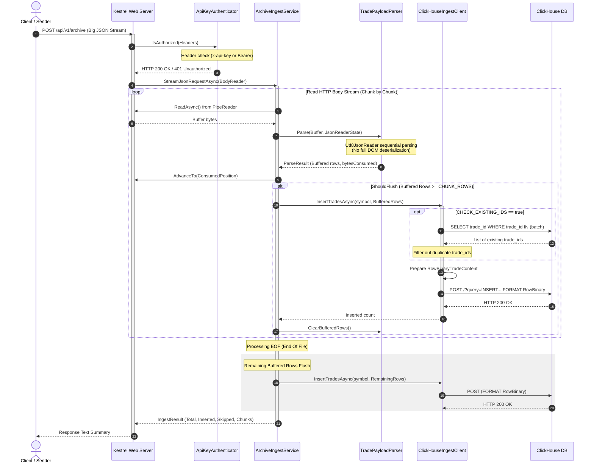

### 시스템 컴포넌트 아키텍처

### 데이터 수집 흐름 시퀀스 다이어그램

### 핵심 아키텍처 디자인 특징

1. 스트리밍 JSON 파서:
    - 큰 용량의 JSON 페이로드 전체를 한 번에 메모리 객체 그래프(`List<T>`)로 로드하지 않음
    - `PipeReader`와 `Utf8JsonReader`를 조합하여 네트워크 버퍼에 들어오는 대로 순차 파싱을 처리하므로, 가비지 컬렉터 부하와 메모리 풋프린트를 극도로 억제함
2. 이중 중복 제거:
    - 애플리케이션 단 필터링: `CHECK_EXISTING_IDS=true`인 경우 ClickHouse에 쿼리를 날려 이미 존재하는 `trade_id`를 걸러내고 새 데이터만 인서트 함
    - 데이터베이스 단 병합: ClickHouse 테이블 엔진으로 `ReplacingMergeTree(symbol, trade_id)`를 채택하여, 백그라운드 머지 시점에 자동 중복 제거가 이루어지도록 설계 되어 있음
3. 고속 바이너리 인서트:
    - ClickHouse 전송 시 텍스트 기반 SQL이나 JSON 포맷을 사용하지 않고, CPU/네트워크 대역폭 효율이 극대화된 ClickHouse 네이티브 `RowBinary` 포맷으로 직접 인코딩하여 전송함
4. 네이티브 AOT:
    - `CreateSlimBuilder` 기반으로 빌드되어 .NET 런타임 없이 단독 실행 가능한 Native AOT 컨테이너 빌드를 완벽히 지원하며, 컨테이너 부팅 시간 단축과 메모리 사용량 최소화를 실현함