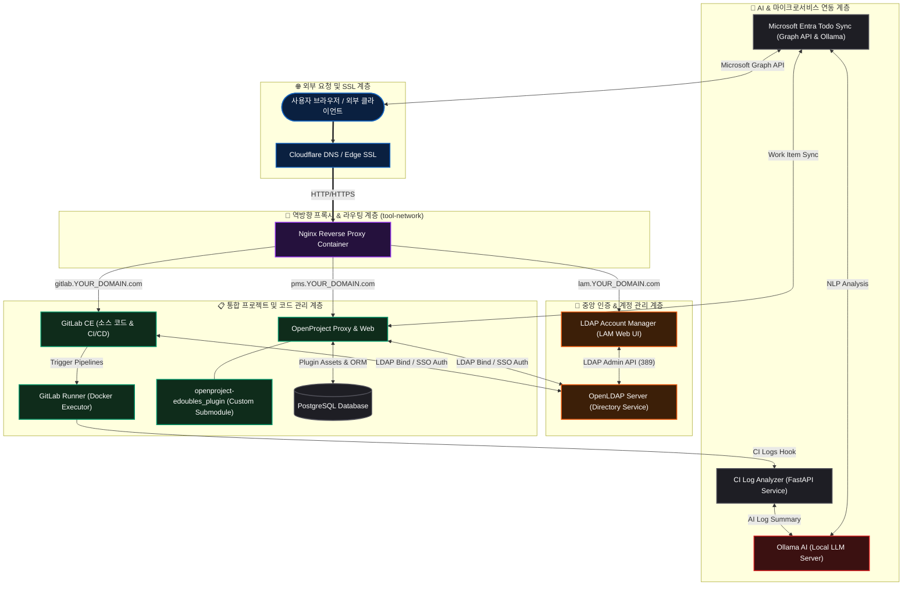

> **프로젝트 구분**: **(주)PS오닉스** 외주 구축 프로젝트

### 아키텍처 다이어그램

## 주요 구성 요소 설명

### 1. Nginx 역방향 프록시 & 도메인 격리 네트워크
* 외부 단일 접점으로 Nginx 컨테이너를 배치하고 Cloudflare 엣지 SSL과 연동하여 SSL/TLS 암호화 통신을 처리함
* 서브도메인 기반 라우팅(`pms.*`, `gitlab.*`, `lam.*`)을 수행하며, Docker 커스텀 브릿지 네트워크(`tool-network`)로 컨테이너 간 안전한 격리 통신을 제공함

### 2. 중앙ized OpenLDAP & LAM 통합 인증 계층
* 기업 내부 사용자 계정, 부서 그룹, 접근 권한 정보를 OpenLDAP 디렉터리 서버로 단일 중앙화함
* LDAP Account Manager (LAM) 웹 인프라를 구축하여 GUI 상에서 실시간 사용자 등록/수정/그룹 할당이 가능하도록 함
* GitLab CE 및 OpenProject의 회원가입/인증 프로세스를 OpenLDAP과 연동하여 단일 계정 기반 SSO(Single Sign-On)를 구현함

### 3. OpenProject (커스텀 플러그인 & Git 서브모듈)
* OpenProject 코어 패키지에 자체 개발 젬/플러그인(`openproject-edoubles_plugin`)을 독립 Git 서브모듈로 통합 관리함
* Docker Multi-stage 빌드 파이프라인을 구축하여 에셋 precompile 및 Rails/Node 파이프라인을 컨테이너화하여 일관된 실행 환경을 보장함
* PostgreSQL 데이터베이스 및 Background Worker 프로세스와 연동하여 프로젝트/이슈/간트차트 및 작업 흐름을 총괄 관리함

### 4. GitLab CE & Automated CI Log Analyzer
* 자체 호스팅 GitLab CE 및 Docker Executor 기반 GitLab Runner를 구축하여 소스 코드 버전 관리와 CI/CD 파이프라인 자동화를 수행함
* CI/CD 파이프라인 실행 중 발생하는 빌드/테스트 실패 로그를 `ci-log-analyzer` 마이크로서비스로 전달하고, 로컬 LLM(Ollama)과 연동하여 실패 원인 및 해결 방안을 자동 요약 분석함

### 5. Microsoft Entra & Todo Sync 마이크로서비스
* Microsoft Entra (Azure AD) Graph API와 연동하여 Office 365 / To-Do 일정을 OpenProject 및 Ollama AI 기반 작업 항목과 양방향 자동 동기화함
