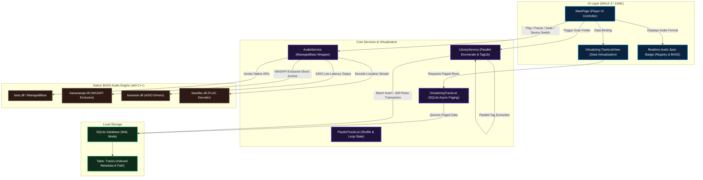
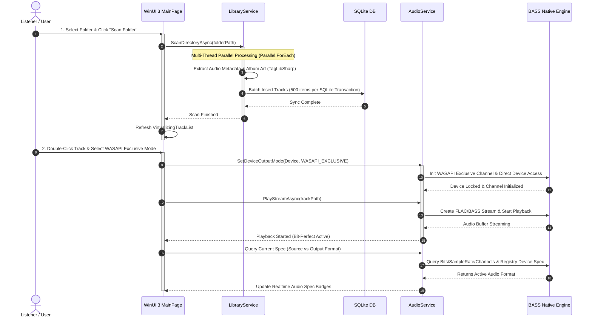

### 시스템 컴포넌트 아키텍처

### 음원 스캔 및 오디오 재생 흐름 시퀀스 다이어그램

### 핵심 아키텍처 디자인 특징

1. 하이파이(Hi-Fi) 비트퍼펙트 재생 파이프라인:
    - **WASAPI Exclusive & ASIO 모드**: Windows 오디오 엔진의 믹서를 우회하고 사운드카드를 직접 제어하여 음원의 원본 샘플링 레이트와 비트 깊이를 왜곡 없이 출력
    - **네이티브 BASS 엔진 통합**: `ManagedBass`, `ManagedBass.Wasapi`, `ManagedBass.Asio`, `ManagedBass.Flac` 네이티브 C++ DLL 래핑을 통해 초저지연 FLAC 무손실 재생 보장
2. 대용량 라이브러리 고속 스캔 및 DB 배치 최적화:
    - **병렬 메타데이터 파싱**: `Parallel.ForEach`를 이용해 태그 정보(`TagLibSharp`)와 앨범 아트를 다중 스레드로 고속 추출
    - **SQLite 배치 트랜잭션**: 500개 단위 배치 트랜잭션을 채택하여 디스크 I/O 병목을 최소화하고 트랜잭션 수백 배 최적화
3. UI 데이터 가상화 (Data Virtualization):
    - **VirtualizingTrackList 구현**: 수만 곡의 라이브러리 스크롤 시 메모리 상승과 UI 멈춤 현상을 방지하기 위해 SQLite 비동기 페이징(100개 단위) 기반 Virtualization 적용
4. 실시간 오디오 스펙 트래킹 & 검출:
    - Windows 레지스트리 직조회를 통해 하드웨어 실제 비트 깊이를 검출하고, 재생 중인 음원의 원본 스펙과 실제 출력 장치 스펙을 실시간 비교 뱃지로 표시
